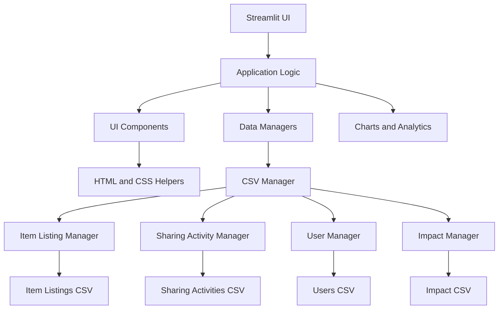

# CampusLoop

A campus resource-sharing platform for discovering, lending, borrowing, swapping, and giving away items — built around responsible consumption and reusable data workflows.


---

## Product Overview

CampusLoop helps students find what they need on campus before buying new. The platform connects three loops:

1. **Discovery** — search and filter available listings across categories, sharing modes, and conditions.
2. **Sharing activity** — record borrows, swaps, giveaways, and sales with full CRUD lifecycle.
3. **Impact** — quantify value retained, items reused, and material reuse factors from actual activity data.

The application is a single Streamlit web app backed by four CSV datasets that act as the persistent source of truth. Every write operation updates the CSV atomically, and every read reflects the latest file state. The UI is a custom dark/light glass interface with a motion-rich, premium visual system.

---

## Core Workflow

**Need something → Discover → Inspect → Choose sharing option → Record activity → Complete → Measure impact**

- **Discover** listings with search, filters (category, mode, condition, status), and sorting.
- **Inspect** a listing detail card with key facts, sharing terms, and owner information.
- **Choose** a sharing mode (Borrow, Swap, Giveaway, Sell) and start the activity.
- **Record** the activity in the Sharing page — creates a new row in `sharing_activities.csv`.
- **Complete** the activity (update status, resolution, return) and the impact dataset captures estimated value saved and reuse metrics.
- **Measure** impact on the Impact and Analytics pages with dynamic charts and aggregated statistics.

---

## Features

### Discovery
- Full-text search across title, category, and pickup location.
- Filters: category, sharing mode, condition, status.
- Multi-field sorting (newest, oldest, title, value).
- Responsive listing cards with inline detail view.

### My Listings (CRUD)
- Create listings with validated form (title, category, type, brand, condition, mode, status, value, dates, location).
- Browse, search, and filter personal listings in a paginated table.
- Update any field of an existing listing.
- Delete with confirmation.
- Atomic CSV persistence with automatic cache invalidation.

### Sharing
- Record new sharing activities (item, borrower, owner, type, dates, value, status).
- Validate item existence, distinct borrower/owner, and date ordering.
- Manage existing activities: update status/resolution/return, delete with confirmation.
- Filter by activity type and status; paginated table with inline detail.

### Users
- Searchable, filterable user directory (name, email, department, year, status).
- Read-only manager (dataset owned by another team member).
- Statistics cards: total members, active/inactive counts, departments represented.

### Impact
- Aggregated metrics: activities, estimated value saved, items reused, average reuse factor.
- Visualizations: value saved by category (horizontal bar), activity type mix (donut), monthly value saved (line), reuse factor distribution (histogram).
- Category breakdown table with activities, value saved, items reused, average factor.

### Analytics
- Dynamic filters (category, sharing mode) that drive metrics and charts.
- Sharing mode mix (donut), top categories (horizontal bar), listing volume over time (line), value distribution (histogram), activity status (donut), pickup hotspots (horizontal bar).
- All charts update instantly when filters change.

### Smart Match
- **Deterministic, rule-based matching** — no external AI/ML service.
- Scoring factors: category match, sharing mode match, condition threshold, availability status, available-until date.
- Returns a percentage score (0–100) and human-readable reasons for each match.
- Preferences persisted in session state; results capped at top 12 matches.

---

## Application Pages

| Page | Purpose |
|------|---------|
| **Home** | Product overview, live stats, recent listings, activity feed, sharing-mode breakdown |
| **Discover** | Search, filter, sort, and inspect available listings |
| **My Listings** | Full CRUD for item listings (create, browse, update, delete) |
| **Sharing** | Record and manage sharing activities (borrow, swap, giveaway, sell) |
| **Users** | Explore campus community members (read-only) |
| **Impact** | Sustainability metrics and visualizations from sharing activity |
| **Analytics** | Catalogue and circulation intelligence with dynamic charts |
| **Smart Match** | Explainable, rule-based item matching |
| **About** | Data overview, export, presentation settings, project credits |

---

## Architecture



**Layers**

1. **Presentation** — `app.py` routes to page functions, injects CSS, renders top navigation.
2. **Page Logic** — each page function composes UI components, handles forms, filters, and calls managers.
3. **UI Components** — reusable HTML/CSS generators (`components.py`), chart builders (`charts.py`), theme/CSS (`theme.py`).
4. **Manager / Data-Access** — `CSVManager` base with atomic write, concrete managers for each dataset.
5. **Persistence** — four CSV files in `data/`; file modification timestamps drive `@st.cache_data` invalidation.
6. **Analytics / Visualization** — Pandas/NumPy aggregations fed to Plotly charts rendered via `plot_card`.

---

## Technology Stack

| Technology | Role |
|------------|------|
| Python 3.14+ | Application logic |
| uv | Environment & dependency management |
| Streamlit 1.66+ | Web application framework |
| Pandas 3.1+ | Data manipulation, filtering, aggregation |
| NumPy 2.5+ | Numerical operations, histograms |
| Plotly 7.1+ | Interactive visualizations |
| CSV | Persistent data storage (source of truth) |

All dependencies declared in `pyproject.toml` and locked in `uv.lock`.

---

## Data Model / Datasets

The `data/` directory contains four CSV files. Each acts as the single source of truth for its domain.

### `item_listings.csv`
Columns: `item_id`, `owner_user_id`, `title`, `category`, `item_type`, `brand`, `condition`, `sharing_mode`, `status`, `estimated_value_inr`, `listed_date`, `available_until`, `pickup_location`

### `sharing_activities.csv`
Columns: `activity_id`, `item_id`, `borrower_user_id`, `owner_user_id`, `activity_type`, `start_date`, `request_date`, `due_date`, `activity_status`, `duration_days`, `estimated_value_inr`, `resolution_status`, `return_status`

### `users.csv`
Columns: `user_id`, `name`, `email`, `department`, `year`, `joined_date`, `account_status`

### `impact.csv`
Columns: `impact_id`, `activity_id`, `user_id`, `activity_type`, `impact_date`, `items_reused`, `duration_days`, `estimated_value_saved_inr`, `estimated_material_reuse_factor`, `item_category`, `impact_category`

*Current sample record counts (approx.):* listings ~5,000, activities ~8,000, users ~1,000, impact ~8,000. These are real project datasets, not generated demo data.

---

## CRUD Architecture

Each owned dataset has a dedicated manager class inheriting from `CSVManager`:

| Manager | Dataset | Key Methods |
|---------|---------|-------------|
| `ItemListingManager` | `item_listings.csv` | `add`, `update`, `delete`, `search`, `get_new_id` |
| `SharingActivityManager` | `sharing_activities.csv` | `add`, `update`, `delete`, `get_active_borrows`, `get_by_item` |
| `UserManager` | `users.csv` (read-only) | `load`, `get`, `filter_by_department` |
| `ImpactManager` | `impact.csv` (read-only) | `load`, `get_summary`, `get_by_category` |

**Base `CSVManager`** provides:
- **Create** — `add` builds a new row, generates a sequential ID (`Ixxxx` or `Axxxxxx`), prepends to DataFrame, saves atomically via temp-file replacement.
- **Read** — `load` reads CSV with robust error handling (missing, empty, malformed); `get`, `filter`, `count`, `unique`.
- **Update** — `update` locates record by ID, applies dict of changes, saves.
- **Delete** — `delete` removes record by ID, saves.
- **Validation** — required fields checked in page forms; duplicate IDs prevented by sequential generation.
- **Persistence** — `save` writes to a temporary file then `os.replace` for atomicity; fallback direct write on failure.
- **Reload behavior** — `@st.cache_data` keyed by file mtime; `invalidate()` clears cache on writes.

---

## Data Integrity and Error Handling

- **Missing/empty/malformed CSV** → `load` returns empty DataFrame with expected columns.
- **Invalid IDs** → `get`/`update`/`delete` raise `ValueError` surfaced as user-facing error via `st.error`.
- **Duplicate IDs** — prevented by sequential ID generation.
- **Invalid user input** — form validation (required title, date ordering, distinct borrower/owner, existing item ID) before manager call.
- **Failed writes** — atomic temp-file replace; fallback direct write; UI shows error flash, data unchanged.
- **Cache invalidation** — `invalidate()` clears all `@st.cache_data` on successful write; mtime-based cache key auto-refreshes on external file change.

---

## Requirements

- **Python** ≥ 3.14 (as declared in `pyproject.toml`)
- **uv** ≥ 0.12 (for dependency management and running)
- A modern web browser (Chrome, Firefox, Edge, Safari)
- OS: Linux, macOS, or Windows (Streamlit runs cross-platform)

---

## Installation

```bash
git clone https://github.com/gitcasino/campus-loop.git
cd campus-loop
uv sync
```

`uv sync` creates a virtual environment (`.venv/`) and installs exact dependencies from `uv.lock`.

---

## Running the Application

```bash
uv run streamlit run app.py
```

The app starts on `http://localhost:8501` (default Streamlit port). The page title is **CampusLoop**; the favicon uses `assets/favicon.png`.

---

## Testing / Verification

**Automated tests:** *none currently in the repository.*

**Static checks:** `git diff --check` and `uv run python -m py_compile app.py` pass.

**Manual QA workflow** (used during development):
1. Run the app, navigate every page.
2. Create a listing → verify row appears in `data/item_listings.csv`.
3. Update the listing → verify CSV change.
4. Delete the listing → verify removal.
5. Record a sharing activity → verify `data/sharing_activities.csv`.
6. Apply filters on Discover/Analytics → confirm charts update.
7. Run Smart Match with various preferences → check scores and reasons.
8. Toggle theme (dark/light) and reduce-motion checkbox → verify UI adapts.
9. Resize browser window → check responsive layout (cards reflow, tables scroll).
10. Open browser devtools console → confirm no JavaScript errors.

---

## Academic Context

CampusLoop was developed as a **Python data-analytics web application project** for the course **22AIE205 — Introduction to Python**. The repository demonstrates:

- CSV-backed persistence with safe atomic writes.
- Object-oriented manager classes for CRUD and data access.
- Pandas for filtering, aggregation, and time-series analysis.
- NumPy for histograms and numerical computations.
- Plotly for interactive, theme-aware visualizations.
- Deterministic, explainable matching algorithm.
- Streamlit custom HTML/CSS/JS for a premium, motion-rich interface.
- Dataset ownership split across team members (listings/activities, users, impact).

---

## Limitations

- **CSV persistence** — no database; concurrent writes are not protected (single-user prototype).
- **No authentication** — user identity is a free-text field; no login, sessions, or authorization.
- **No multi-user concurrency guarantees** — simultaneous edits may overwrite each other.
- **No external integrations** — no messaging, payments, calendar, or campus system APIs.
- **Smart Match is deterministic** — rule-based scoring; not machine learning.
- **Streamlit constraints** — server-side rendering, single-threaded script execution; custom components used for motion/3D but business logic remains in Python.
- **Sample dataset scale** — current CSVs are project-sized (~5k–8k rows); performance on significantly larger data untested.

---

## Future Improvements

- Database-backed persistence (SQLite/PostgreSQL) with transactions.
- Authentication & authorization (roles: owner, borrower, admin).
- Transactional concurrency control (optimistic locking, row-level locks).
- Automated test suite (pytest for managers, Playwright for UI).
- REST/GraphQL API layer for external consumers.
- Notification system (email, in-app) for due dates, status changes.
- Richer matching (location proximity, historical preference, collaborative filtering).
- Deployment observability (logging, metrics, health checks).
- CI/CD pipeline (lint, type-check, build, deploy preview).

---

## Contributing

```text
Fork the repository
→ Create a feature branch
→ Make changes (code, UI, docs)
→ Verify locally (run app, test CRUD, check CSV persistence)
→ Commit with clear messages
→ Open a pull request
```

Keep contributions focused; avoid unrelated refactors in the same PR.